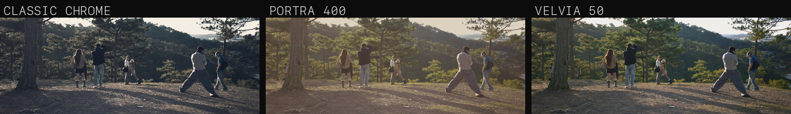
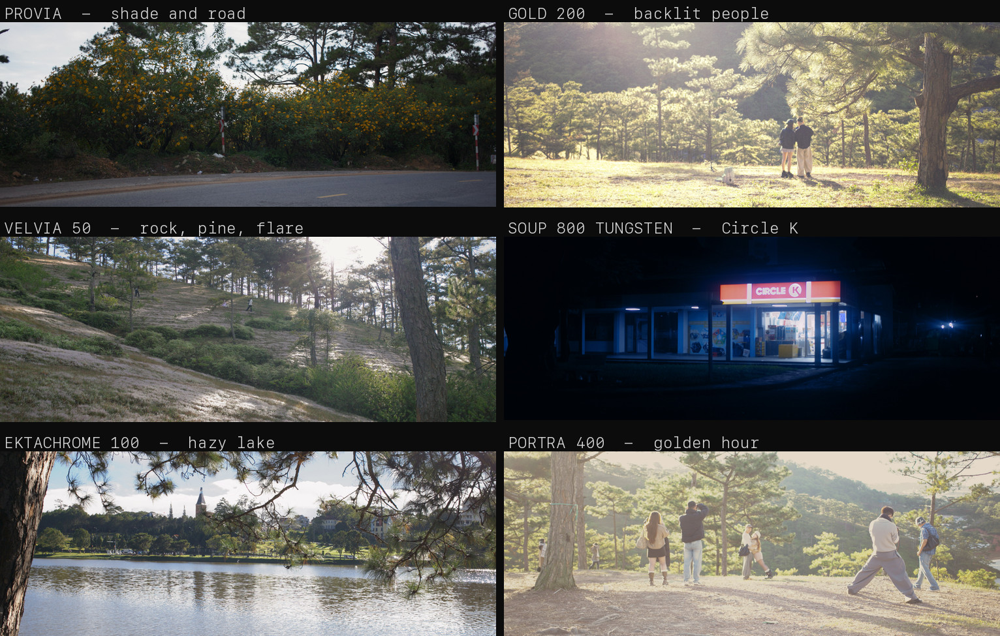

# XPan Digital — Canon EOS 6D

One frame, one camera, one recipe: the 6D's raw, decoded and graded by this
module's engine, cropped to the 65:24 window the camera framed. Đà Lạt,
2 November 2026.

The same frame through three shipped recipes — cool and muted, warm and open,
saturated and contrasty. A stock here is a bundle of curve, hue axes, split tone
and grain, not a colour filter, and the gap between these three is the product.

> ## Disclaimer — read before installing
>
> **This is unofficial, unsupported software.** It is not affiliated with,
> endorsed by, or supported by Canon, Hasselblad, Fujifilm, OM System, or the
> Magic Lantern project. Names such as "XPan", "Portra" or "Classic Chrome" are
> used to describe what a look imitates; they are trademarks of their owners.
>
> **It runs as a firmware payload on your camera.** Like Magic Lantern itself,
> it loads code the manufacturer never intended to run. That can, in principle,
> damage the camera, corrupt a card, lose photographs, or leave the body needing
> a service centre. Everything here is provided **"as is", with no warranty of
> any kind**, and you install it entirely at your own risk.

A Magic Lantern module for the EOS 6D that does two things the camera cannot do
on its own: it writes a film look into the JPEG **at the shutter**, and it
frames the sensor at **65:24**, the panoramic shape of a Hasselblad XPan.

## What it is an imitation of

The camera this is modelled on is not a Canon.

**Hasselblad XPan** (and the Fujifilm TX-1 it was built beside): a 35 mm
rangefinder that exposes **24 × 65 mm** — 2.7:1 — by using the sprocket areas
that every other 35 mm camera throws away. That is where `Aspect ▸ 65:24 XPan`
comes from, and why Develop writes a 5472×2020 file instead of cropping a 3:2
one.

**Fujifilm's film simulation**: a look is not a filter but a bundle of named
settings — tone curve, colour, colour chrome, grain — saved as a recipe. That is
what a `.fs` is here, and the Fuji recipe screen carries those fields with
Fuji's own ranges.

**OM System's colour creator**: twelve wedges around a wheel, each with its own
saturation, hue rotation and luminance, instead of six global axes. That is the
12-wedge creator in `Custom Look`.

**Magic Lantern**, most of all: none of this exists without it. ML is the
firmware layer that makes a retired Canon body hackable at all — the property
API, the display filter, the task system, the file I/O. This project is a module
bolted onto their work, it is GPL v2 because ML is, and the people who reverse
engineered this body deserve the credit for everything below that is not the
look engine. Thank you.

## What it does

* **The look is in the JPEG the camera writes.** Not a second file, not
  post-processing, no CR2 round trip: the frame is graded on its way to Canon's
  own encoder. ([Which firmware path that is](docs/how-it-works.md).)
* **84 film looks**, each an editable recipe — tone curve, twelve hue knots, split
  tone, halation, grain. Any of them can be tweaked, exported as a 3D `.cube`, or
  replaced with one you wrote.
* **65:24 panoramic framing**, the XPan shape, with bars on LiveView so you
  compose what you get.
* **A 12-wedge colour creator** in the camera: per-wedge saturation, hue rotation
  and luminance, saved into four slots.
* **Fuji recipe entry** with Fuji's own fields and ranges, plus a WB shift that is
  pushed to the camera and read back.
* **Develop on the camera**: current photo, a marked set, a 4-up comparison, or
  automatic — with the look that was chosen at the shutter.
* **Grade Quality** — High / Normal / Fast for the in-shutter grade, because
  that grade sits in Canon's pipeline and the next frame waits for it. High is
  the full look; Fast applies the tone curve only and costs a fifth of the time.
* **The same look in LiveView** while you compose.

## The film shelf

`SET` moves to the next stock, `Q` goes back, and the strip scrolls. The canister
artwork is parsed from `ML/data/FILMCAN.DAT` by the same code the host preview
uses, so what the LCD shows is what the preview renders.

The glide is a spring, not an ease — position and velocity in fixed point,
integrated in 8 ms sub-steps on the same 30 ms clock the panel repaints on, so a
late frame cannot fling the strip
([`gui/fs_spring.h`](magiclantern/modules/film_sim/gui/fs_spring.h)). The
animation below is that integrator stepped for three slots of travel, one frame
per tick, drawn by the camera's own strip drawer:

## The screens

Every camera screen in this README is drawn by the module's own drawing code
([`gui/fsg.c`](magiclantern/modules/film_sim/gui/fsg.c),
[`fsg_creator.c`](magiclantern/modules/film_sim/gui/fsg_creator.c),
[`fsg_wb.c`](magiclantern/modules/film_sim/gui/fsg_wb.c)) on the desktop, through
the same two primitives the camera uses: `fsg_fill` and `fsg_text`, implemented
with `bmp_*` on the panel and into an RGB buffer on a Mac. There is no mockup
layer, so a row in the wrong place here is a row in the wrong place on the LCD.
The one thing that is not the camera's is the glyphs — the preview sets the text
in Arial, so a line can be a few pixels wider than ML's font box; positions,
colours and every fill are the panel's. The palette is eight-bit indices — 48
fills for the wheel alone — because that is what the panel has:

Every screen here is drawn by the module's own drawing code on a desktop, through
the same two primitives the camera uses — no mockup layer. The command that
renders them is in [build.md](docs/build.md#rendering-the-screens); the
animations are the camera's own springs, stepped frame by frame.

## 65:24 XPan

*Six frames, each on the stock it would actually have been shot on: **Provia**
for a road under deep pines, **Gold 200** for two people standing in backlight,
**Velvia 50** for rock and flare, **Soup 800** (Vision3 500T) for a Circle K at
night, **Ektachrome 100** for a hazy lake, **Portra 400** for golden hour. Every
cell is a level-3 raw develop from the camera's own file, cropped to 65:24, and
exposed to match Canon's own JPEG of the same frame — mean luma within a
point, no cell clipping where Canon's did not.*

`Aspect ▸ 65:24 XPan` frames the panel at 2.708:1 and Develop writes a real
5472×2020 JPEG — the rows outside the window are never encoded, so the file is
smaller and the grain is right. Capture is the honest exception: Canon decides
the dimensions of the JPEG it writes, so at the shutter the framing is burned in
as bars (see [Limits](#limits--stated-plainly)).

## Samples

Eleven Đà Lạt frames off the 6D this module runs on, the morning of 2 November
2026: in each row the frame with no look, then Portra, Classic Neg, Velvia and
Tri-X. The samples themselves are develops of the camera's raw files — its own
JPEGs from that morning carry the look that was in the slot, cast and all —
and the graded tiles are the module's develop colour path, only enlarged.
Provenance and the commands that rebuild all of it are in
[samples/](samples/README.md).

## A Fuji recipe, field for field

A recipe on a Fuji body is not a screen — it is a bundle of I.Q. menu items saved
into a C1..C7 slot. Here that bundle is a `.fs`, with Fuji's own field names and
ranges: tone curve highlight/shadow, colour, colour chrome effect and FX blue,
grain effect and size, and a WB shift on Fuji's Red/Blue axes that is pushed to
the camera and read back rather than baked into the file.

Three fields a published recipe carries are **not** offered, because they cannot
be honoured here: `DYNAMIC RANGE`, `CLARITY` and `HIGH ISO NR`. A knob that does
nothing is worse than an absent row. The full mapping, field by field, is in
[fuji-recipe-fields.md](docs/fuji-recipe-fields.md).

## Install on a new card

1. Format the card **in the camera** (Menu → Format card).
2. Copy `autoexec.bin`, `ML-SETUP.FIR` and `ML/` from the release zip to the card root.
3. Make the card bootable: run the firmware update once with `ML-SETUP.FIR` on the
   card, or set the `EOS_DEVELOP` + `BOOTDISK` flags from a reader.
4. Power on, press **ERASE** to open the ML menu, then **Modules → Film Sim**.

Then open **Film Shelf** — the first row of the module's menu — and pick a stock.
Everything else is under **Film Settings**: `Level` (1 writes the look into a
picture style and lets the camera bake it; 2 grades the frame at the shutter; 3
decodes the sensor raw first — full RAW only, mRAW is not implemented and the
menu says so), strength, saturation, grain, **Aspect** (3:2, 1:1, 4:5, 9:16,
16:9, 65:24 XPan, 2.39:1 Cinemascope), the looks and the capture options.
Develop is always explicit: **Develop ▸ Current Photo / Darkroom / Comparison x4**.

Full walk-through, including updating a card that already boots ML and where
every file lands: **[install.md](docs/install.md)**.

## Limits — stated plainly

* **Aspect ratio cannot be baked into Canon's JPEG.** The camera writes
  5472×3648 at the full sensor shape, and a module can only write pixels into
  the YUV buffer, not change the dimensions of the file. `Aspect` therefore
  draws bars on LiveView and the crop is applied afterwards; Develop output is
  cropped for real.
* **Two routes, one look, and only one of them is on by default.** The stock can
  be written into the picture style (Canon applies it while it builds the YUV —
  the shipped default) or the frame can be graded in-shutter off a Neutral base
  (`film.sim.capture` + `film.sim.neutralcap`). Running both stacks two looks;
  running neither leaves Canon's own rendering. Which one a build is doing is in
  the log, not in the menu.
* **The clock inside the hook under-counts.** Halving `film.sim.yuvrows` halved
  the wall-clock wait (8 s → 4 s) while the reported time halved with it
  (817 → 408), so read those numbers as relative, not absolute.
* QEMU is not a usable test bed in this workspace; verification is on the camera
  or in `se/hosttest`.

## 84 film stocks, and what came from M-Film

The shelf holds 84 looks: 34 `.fs` recipes shipped in this repository — Kodak,
Fujifilm, Ilford, Foma, CineStill, and a few authored ones such as Olympus
Natural — plus the catalogue imported from the M-Film project. Each carries its
own tone curve, twelve hue knots, split tone, halation and grain, and each can be
edited, exported as a 3D `.cube`, or replaced by anything you write.

Where they came from, what was measured against M-Film, and what was deliberately
left out: [m-film.md](docs/m-film.md).

## Documentation

| | |
|---|---|
| [install.md](docs/install.md) | new card, updating an existing one, what lives where |
| [how-it-works.md](docs/how-it-works.md) | the hooked firmware path, what is written into the frame, what it costs, and how each claim was verified |
| [build.md](docs/build.md) | tree layout, macOS build, rendering the screenshots |
| [looks.md](docs/looks.md) | authoring a look, exporting it as a `.cube`, loading an external LUT |
| [fuji-recipe-fields.md](docs/fuji-recipe-fields.md) | Fuji's I.Q. fields against what this module honours |
| [m-film.md](docs/m-film.md) | where the imported stocks came from |
| [release.md](docs/release.md) | the gates a release passes, and how to read the hashes |
| [wifi-functions.md](docs/wifi-functions.md) | what the 6D's WiFi stack actually is, and why it is not driven |
| [sooc.md](docs/sooc.md) | whether a straight-out-of-camera frame carries the look once, twice or not at all |

## Licence

GPL v2, the same licence Magic Lantern itself ships under — see
[LICENSE](LICENSE), which is a byte-identical copy of the `COPYING` file in
[`magiclantern/`](magiclantern/COPYING). The module links against ML's own code,
so it cannot carry a different licence than the thing it is built into.

Two things in the tree are other people's work, and this file is not a claim
about their terms: the canister artwork parsed from `ML/data/FILMCAN.DAT` and the
recipes derived from M-Film (both come from the FilmRoll project — see
[`docs/m-film.md`](docs/m-film.md)). Everything else under `magiclantern/` is
Magic Lantern upstream, including the prebuilt `src/libs/*.a` archives.
