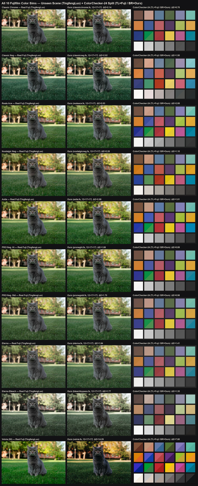

# Fujifilm Film Simulations — Full 11-Sim Calibration & Comparison Report

- **Engine:** On-camera `12×17×17` YUV422 lattice (`magiclantern/modules/film_sim/se/hosttest/ship3`)
- **9 Digital Fujifilm Color Sims** (`Classic Chrome`, `Classic Neg`, `Reala Ace`, `Nostalgic Neg`, `Astia`, `PRO Neg. Hi`, `PRO Neg. Std`, `Eterna`, `Eterna Bleach`) calibrated to verified **Fujifilm X-Trans 4** `Provia → Sim` 3D LUTs (`abpy/FujifilmCameraProfiles`) across 101 Canon 6D scenes + ColorChecker-24 + 3D Hue/Lum sweep.
- **Velvia (50)** & **Acros (B&W)** are kept at their **Dehancer Pro analog film** calibration (included here for direct cross-comparison against digital Fujifilm).
- **Independent validation:** 4 unseen real Fujifilm camera JPEGs (`friimaind` 3 scenes + `TingfengLuo` 1 scene).

## Summary Table (CIEDE2000)

| Fujifilm Sim | `.fs` File | Real Fuji Scenes (Mean / P95) | ColorChecker-24 (Mean / P95) | Skin / Neutral | 3D Sweep (Mean) | Comparison Board |
|---|---|---:|---:|---:|---:|---|
| **Classic Chrome** | `classicchrome.fs` | **1.99** / 4.41 | **0.70** / 1.95 | 0.62 / 0.72 | 1.59 | [board.jpg](Fujifilm-Classic-Chrome/board.jpg) |
| **Classic Neg** | `classicneg.fs` | **2.33** / 4.77 | **1.50** / 2.63 | 1.44 / 1.45 | 2.43 | [board.jpg](Fujifilm-Classic-Neg/board.jpg) |
| **Reala Ace** | `realaace.fs` | **2.37** / 5.15 | **2.08** / 4.72 | 1.35 / 1.28 | 3.03 | [board.jpg](Fujifilm-Reala-Ace/board.jpg) |
| **Nostalgic Neg** | `nostalgicneg.fs` | **3.28** / 8.44 | **1.10** / 2.19 | 1.51 / 0.87 | 2.52 | [board.jpg](Fujifilm-Nostalgic-Neg/board.jpg) |
| **Astia** | `astia.fs` | **2.23** / 5.00 | **1.01** / 2.06 | 1.62 / 0.91 | 1.94 | [board.jpg](Fujifilm-Astia/board.jpg) |
| **PRO Neg. Hi** | `proneghi.fs` | **2.00** / 4.68 | **0.89** / 2.05 | 1.45 / 0.34 | 1.97 | [board.jpg](Fujifilm-Pro-Neg-Hi/board.jpg) |
| **PRO Neg. Std** | `pronegstd.fs` | **2.05** / 4.71 | **0.98** / 3.08 | 1.20 / 0.41 | 2.10 | [board.jpg](Fujifilm-Pro-Neg-Std/board.jpg) |
| **Eterna** | `eterna.fs` | **2.20** / 5.04 | **1.41** / 2.64 | 1.44 / 0.49 | 2.16 | [board.jpg](Fujifilm-Eterna/board.jpg) |
| **Eterna Bleach** | `bleachbypass.fs` | **1.95** / 3.96 | **1.35** / 2.40 | 1.69 / 0.87 | 2.62 | [board.jpg](Fujifilm-Bleach-Bypass/board.jpg) |
| **Velvia (50)** | `velvia.fs` | **10.53** / 18.84 | **7.80** / 14.79 | 8.63 / 8.19 | 11.40 | [board.jpg](Fujifilm-Velvia/board.jpg) |
| **Acros (B&W)** | `acros.fs` | **6.14** / 10.79 | — | — | — | [board.jpg](Fujifilm-Acros/board.jpg) |

## Overview Board — All 10 Color Sims (Unseen Scene + ColorChecker-24 Diagonal Split)

